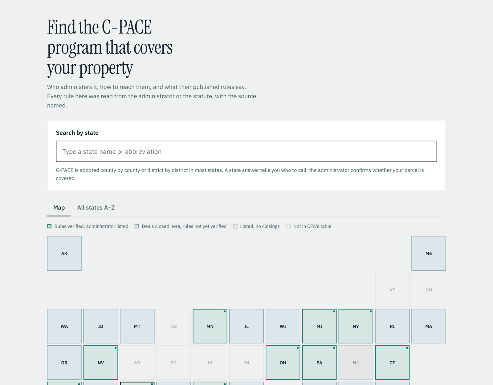

# C-PACE Program Finder

A free reference for developers, lenders and program administrators: who runs the
C-PACE program covering a property, how to reach them, and what their published rules say.

Every rule was read from a program administrator's guidelines, FAQ or the enabling
statute, and carries the source and the date it was checked. States that have not been
researched say so rather than showing a plausible guess.

## Status

- 12 states verified: CO, CT, TX, MI, CA, OH, NV, FL, MO, MN, NY, PA
- 21 states with recorded C-PACE volume and rules not yet verified
- 25 administrator contacts across 13 states
- 2 states where two official sources contradict each other, both shown (MN, PA)

## Files

    data/states.json             verified rules, one object per state
    data/administrators.json     who to call, by state
    data/volume-cpa-2024.json    C-PACE Alliance volume table, most recent published
    data/backlog.json            unverified states ranked by 2024 volume
    site/index.html              the site, self-contained, no build step
    research/SOURCES.md          every source, with date checked
    CLAUDE.md                    working rules. Read this first.

Next up: [load the site from the JSON files and add a comparison view](https://github.com/juliechasen-cyber/cpace-finder/issues/1).

## Why this exists

The C-PACE Alliance volume table still shows 2024 as its most recent year. Morningstar
DBRS has put 2025 origination near $4.5 billion against $2.42 billion in 2024. Meanwhile
the EPA publishes a superseded Minnesota term limit and Pennsylvania's environmental
agency publishes eligibility rules a 2022 statute overrode.

Nobody maintains this. That is the opening.
